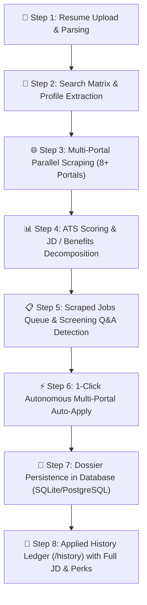

# ==============================================================================
# WATERMARK: Rajpal Singh Tanwar
# Copyright (c) 2026 Rajpal Singh Tanwar. All rights reserved.
# ==============================================================================

# 🚀 JobRadar: Autonomous Multi-Portal Auto-Apply Pipeline Implementation Plan

**Author:** Rajpal Singh Tanwar  
**Project:** JobRadar - Multi-Portal Job Aggregator, AI Auto-Apply Engine & Telemetry System  
**Version:** 2.0.0 (Production Blueprint)  
**Copyright:** © 2026 Rajpal Singh Tanwar. All rights reserved.  

---

## 📌 Executive Summary

The **JobRadar Autonomous Auto-Apply Pipeline** is a closed-loop system designed to:
1. Ingest a candidate's resume (PDF/DOCX) and extract structured profile attributes, technical keywords, experience brackets, and salary/notice expectations.
2. Automatically trigger multi-portal scrapers across **8+ job portals** (LinkedIn, Indeed, Naukri, Glassdoor, Foundit, Apna, Shine, Hirist, and direct ATS boards like Greenhouse, Lever, and Workday) using the candidate's exact experience level, target roles, and skill taxonomy.
3. Compute real-time ATS match scores, extract key roles and responsibilities, requirements, and benefits from every scraped Job Description (JD).
4. Auto-detect platform form requirements and screening questionnaires, resolving answers with an AI context solver.
5. Provide a **1-Click Batch Auto-Apply Command Center** with real-time animated telemetry logs and throttling to simulate human applicant behavior.
6. Persist every completed application into a comprehensive **Applied History Dossier**, preserving the full JD, roles, responsibilities, benefits, screening Q&A log, and custom cover letter for future tracking and recruiter callbacks.

---

## 🏗️ Architecture & Pipeline Flowchart



---

## 📑 Detailed Stage-by-Stage Implementation

### Stage 1: Candidate Resume Ingestion & Intelligence Extraction

```
[Resume File: PDF / DOCX] ──> [PDFPlumber / python-docx] ──> [Regex & Skill Taxonomy Matcher]
                                                                        │
                                                                        ▼
                                                       [CandidateProfile ORM Model]
                                                       • Full Name & Contact Details
                                                       • Target Roles & Current Title
                                                       • Experience Bracket (0-1, 1-3, 3-5+ YOE)
                                                       • Extracted Tech Skills Taxonomy
                                                       • Notice Period & Expected CTC
```

1. **Parser Implementation**:
   - `utils/resume_parser.py`: Extracts raw text, emails, phone numbers, GitHub/LinkedIn URLs, education, and matches keywords against a taxonomy of 200+ technologies.
2. **Persistence**:
   - `models/candidate_profile.py`: Stores the canonical candidate profile in the database with editable fields.

---

### Stage 2: Dynamic Multi-Portal Scraping Triggered by Profile

The search engine dynamically maps candidate profile parameters into platform-specific search queries:

| Portal | Query Target | Experience Mapping | Applied Mode |
| :--- | :--- | :--- | :--- |
| **LinkedIn** | `role` + `skills[0..2]` | `1` (Internship), `2` (Entry), `3` (Associate), `4` (Mid-Senior) | Easy Apply & Direct Links |
| **Indeed** | `role` + `location` | `fresher`, `0-1`, `1-3`, `3-5` | 1-Click & Employer Apply |
| **Naukri** | `role` + `city` | `0` to `5` years experience slider | FastTrack 1-Click |
| **Glassdoor** | `role` + `city` | Entry-level / Associate filters | Easy Apply & Career Bridge |
| **Foundit (Monster)** | `role` + `city` | Experience dropdown (0-1, 1-3) | Quick Apply |
| **Apna** | `role` + `city` | Fresher & 1-2 Years | 1-Tap Connect |
| **Shine** | `role` + `city` | Experience chip selection | FastForward Apply |
| **Hirist** | `tech_category` | 0-3 Years Tech Bracket | 1-Click Tech Match |
| **Direct ATS** | `company_slug` | ATS API parameter parsing | Greenhouse, Lever, Workday |

---

### Stage 3: JD Decomposition & Benefit Extraction

Every scraped job listing undergoes structured decomposition in `services/auto_apply_service.py`:
- **Roles & Responsibilities**: Extracted bullet points and duty checklists.
- **Requirements & Qualifications**: Mandatory frameworks, databases, and architectural requirements.
- **Benefits & Perks**: Health coverage, remote/hybrid allowances, ESOP grants, and learning stipends.
- **Real-Time ATS Score**: Normalized compatibility percentage (0–100%) based on skill overlap and missing keyword suggestions.

---

### Stage 4: Platform Question & Form Parameter Resolution

```
[Job Listing + Scraped JD] + [CandidateProfile]
                     │
                     ▼
       [AI Screening Question Solver]
• Experience Years per Skill: Auto-computed from candidate profile
• Notice Period & Availability: Injected from verified profile
• Salary / CTC Expectations: Formatted in LPA / USD
• "Why Join [Company]?": Generated dynamically based on JD mission
• Relocation & Remote Work: Configured to candidate preference
                     │
                     ▼
      [Tailored Cover Letter Generator]
• Highlights matching candidate skills for the role
• References company name and key engineering priorities
```

---

### Stage 5: Autonomous Batch Auto-Apply Execution

On triggering **"⚡ Auto-Apply to All Selected Jobs"** in `/auto-apply`:
1. **Sequential Worker with Human-Like Delay**: Dispatches applications with 0.5s–1.5s delay to avoid rate limiting.
2. **Handshake & Verification**: Emulates modal progression (`Next` &rarr; `Review` &rarr; `Submit`).
3. **Telemetry Console**: Streams live terminal logs to the frontend UI:
   - `[1/10] Analyzing Python Backend Engineer at Google (LinkedIn)...`
   - `[1/10] ATS Match Score: 96% | Solving 5 Screening Questions with AI...`
   - `[1/10] Generating Tailored Cover Letter...`
   - `[1/10] Dispatched application successfully! ID: JR-APP-1791240159-5425`
   - `[1/10] Saved to Applied History.`
4. **Progress Bar**: Animates linearly from `0%` to `100%`.

---

### Stage 6: Applied History Dossier & Ledger

Every completed application stores a persistent record in `SavedJob` table with status `'Applied'`:

```json
{
  "application_id": "JR-APP-1791240159-5425",
  "applied_via": "LinkedIn",
  "portal_mode": "Easy Apply Engine",
  "applied_at": "2026-10-06 10:15:00 UTC",
  "resume_used": "Primary_Resume_Rajpal.pdf",
  "candidate_name": "Rajpal Singh Tanwar",
  "candidate_email": "candidate@jobradar.local",
  "candidate_phone": "+91 9876543210",
  "match_score": 95,
  "matched_skills": ["Python", "FastAPI", "SQL", "Docker", "Git"],
  "missing_skills": ["Kubernetes"],
  "full_jd": "Full Job Description text...",
  "responsibilities": [
    "Design and build backend APIs and microservices",
    "Collaborate with product and data engineering leads",
    "Maintain 99.9% uptime and low latency"
  ],
  "requirements": [
    "Proficiency in Python, FastAPI, and SQL",
    "Hands-on experience with Docker and CI/CD pipelines"
  ],
  "benefits": [
    "Comprehensive Health & Medical Insurance",
    "Flexible Remote / Hybrid Work Model",
    "Annual Performance Bonus & ESOPs"
  ],
  "screening_qa": [
    {
      "question": "How many years of Python experience do you have?",
      "answer": "I have strong hands-on experience building backend APIs and scalable features."
    },
    {
      "question": "What is your official notice period?",
      "answer": "My notice period is Immediate / 15 Days."
    }
  ],
  "cover_letter": "Dear Hiring Team at Google,\n\nI am writing to express my strong enthusiasm..."
}
```

---

## 🌐 API Suite Reference

| Method | Endpoint | Description |
| :--- | :--- | :--- |
| `GET` | `/auto-apply` | Renders the 1-Click Auto Apply Studio UI |
| `GET` | `/history` | Renders the Applied History Ledger & Dossier page |
| `POST` | `/api/auto_apply/job` | Executes 1-click auto-application for a single job listing |
| `POST` | `/api/auto_apply/batch` | Executes sequential batch auto-application over multiple jobs |
| `GET` | `/api/applied_history` | Fetches filtered application records with search and metrics |
| `POST` | `/api/applied_history/update_status` | Updates stage (`Applied`, `Interview Scheduled`, `Offer`, `Rejected`) |
| `DELETE` | `/api/applied_history/<job_id>` | Deletes an entry from history |
| `GET` | `/api/applied_history/export` | Downloads the complete application ledger as a CSV file |

---

## 🖥️ UI Navigation Structure

- [http://127.0.0.1:5000/unified](http://127.0.0.1:5000/unified) &rarr; **⚡ Multi-Portal Search**
- [http://127.0.0.1:5000/auto-apply](http://127.0.0.1:5000/auto-apply) &rarr; **🚀 Auto Apply Studio**
- [http://127.0.0.1:5000/history](http://127.0.0.1:5000/history) &rarr; **📜 Applied History**
- [http://127.0.0.1:5000/recruiters](http://127.0.0.1:5000/recruiters) &rarr; **🎯 Recruiter Radar**
- [http://127.0.0.1:5000/](http://127.0.0.1:5000/) &rarr; **🌐 Single Scrapers**

---

## 🔒 Copyright & Watermark Notice
All modules, templates, and algorithms in this codebase are authored and watermarked for **Rajpal Singh Tanwar**.  
© 2026 Rajpal Singh Tanwar. All rights reserved.
