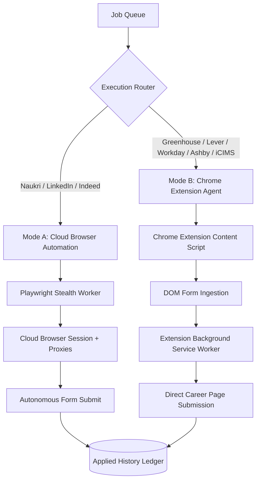
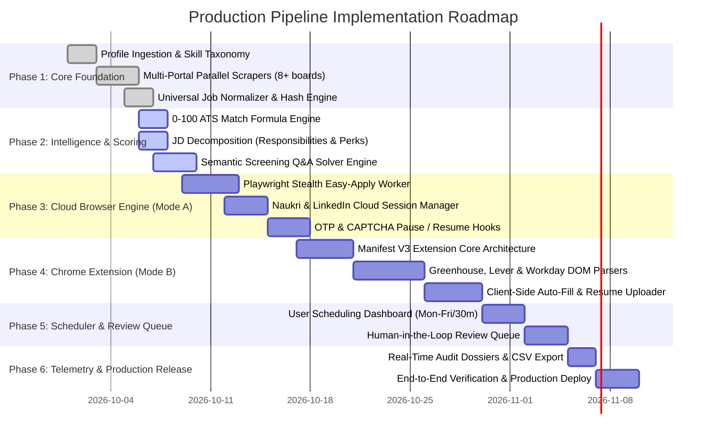

<!--
  WATERMARK: Rajpal Singh Tanwar
  Copyright (c) 2026 Rajpal Singh Tanwar. All rights reserved.
-->

# 🚀 Autonomous Multi-Platform Auto-Apply & Job Scraping Engine (JobRadar AutoPilot AI)
## Enterprise-Grade Production Implementation Plan & Technical Architecture Specification

**Author:** Rajpal Singh Tanwar  
**System Name:** JobRadar AutoPilot AI Enterprise Autonomous Pipeline  
**Version:** 3.0.0 (Production Blueprint & Specification)  
**Copyright:** © 2026 Rajpal Singh Tanwar. All rights reserved.  

---

## 📑 Table of Contents
1. [Executive Summary & Vision](#1-executive-summary--vision)
2. [End-to-End System Architecture Diagram](#2-end-to-end-system-architecture-diagram)
3. [Module 1: User Profile & Candidate Ingestion Engine](#3-module-1-user-profile--candidate-ingestion-engine)
4. [Module 2: Multi-Platform Job Discovery & Aggregation Engine](#4-module-2-multi-platform-job-discovery--aggregation-engine)
5. [Module 3: Universal Job Normalization Engine](#5-module-3-universal-job-normalization-engine)
6. [Module 4: Intelligent Job Matching & Scoring Engine (0–100 ATS Match)](#6-module-4-intelligent-job-matching--scoring-engine-0100-ats-match)
7. [Module 5: Resume Strategy & AI Tailoring Engine](#7-module-5-resume-strategy--ai-tailoring-engine)
8. [Module 6: Dual-Mode Autonomous Application Agent Architecture](#8-module-6-dual-mode-autonomous-application-agent-architecture)
   - *Mode A: Cloud Browser Automation Engine (Naukri, LinkedIn, Indeed)*
   - *Mode B: Chrome Extension / Client-Side DOM Ingestion (Greenhouse, Lever, Workday, Ashby, iCIMS, Rippling)*
9. [Module 7: Form Detection, Field Mapping & Semantic Answer Engine](#9-module-7-form-detection-field-mapping--semantic-answer-engine)
10. [Module 8: Pre-Submission Validation & Human-in-the-Loop Review Queue](#10-module-8-pre-submission-validation--human-in-the-loop-review-queue)
11. [Module 9: Scheduled Job Automation & Background Worker Dispatcher](#11-module-9-scheduled-job-automation--background-worker-dispatcher)
12. [Module 10: Application Tracker, Telemetry & Dossier Persistence](#12-module-10-application-tracker-telemetry--dossier-persistence)
13. [Database Schema & Data Models](#13-database-schema--data-models)
14. [Security, Anti-Bot Avoidance, Rate-Limiting & Compliance](#14-security-anti-bot-avoidance-rate-limiting--compliance)
15. [Phased Implementation Roadmap & Engineering Milestones](#15-phased-implementation-roadmap--engineering-milestones)

---

## 1. Executive Summary & Vision

The **JobRadar AutoPilot AI Enterprise Autonomous Auto-Apply Pipeline** is a closed-loop, production-grade automated application ecosystem. It bridges the gap between passive job searching and high-volume, targeted job applications by orchestrating:
1. **Multi-Source Job Aggregation**: Parallel discovery across major boards (Naukri, LinkedIn, Indeed, Glassdoor, Foundit, Apna, Shine, Hirist) and native enterprise ATS boards (Greenhouse, Lever, Workday, Ashby, iCIMS, Rippling).
2. **Contextual Normalization & ATS Scoring**: Real-time extraction of structured JD attributes, responsibilities, compensation, and deterministic 0–100 ATS match scoring.
3. **Adaptive Resume Selection**: Selection of master PDF resumes vs. dynamic LLM-tailored resumes fine-tuned for specific JD keywords.
4. **Dual Application Execution**:
   - **Cloud Browser Automation Engine** (Playwright/Stealth) for standard web portals and Easy Apply workflows.
   - **Chrome Extension / Content Script Agent** for complex company career pages and multi-step enterprise ATS forms.
5. **Deterministic Form Filling & AI Question Answering**: Semantic resolution of complex screening questions (years of experience, notice period, work authorization, salary expectations, custom situational prompts).
6. **Audit Dossiers & Telemetry**: Immutable logging of full job descriptions, perks, submitted answers, and tailored cover letters with a real-time tracking ledger.

---

## 2. End-to-End System Architecture Diagram

```
                    ┌────────────────────────────────────────────────────────┐
                    │                      USER PROFILE                      │
                    │────────────────────────────────────────────────────────│
                    │ • Master Resume / CV (PDF / DOCX)                      │
                    │ • Technical Skills Taxonomy (200+ canonical keys)      │
                    │ • Work Experience, Roles & Tenure                      │
                    │ • Education & Certifications                           │
                    │ • Target Locations & Remote Preferences                │
                    │ • Current CTC / Expected Salary                        │
                    │ • Notice Period & Availability                         │
                    │ • Work Authorization (Visa status, Citizen, etc.)      │
                    │ • Role & Company Exclusions / Preferences              │
                    └───────────────────────────┬────────────────────────────┘
                                                │
                                                ▼
                    ┌────────────────────────────────────────────────────────┐
                    │                 JOB DISCOVERY MATRIX                   │
                    │────────────────────────────────────────────────────────│
                    │ 🌐 Major Portals: Naukri, LinkedIn, Indeed, Glassdoor  │
                    │ 🌐 Regional/Niche: Foundit, Apna, Shine, Hirist        │
                    │ 🏢 Enterprise ATS: Greenhouse, Lever, Workday,         │
                    │                    Ashby, iCIMS, Rippling, BambooHR    │
                    └───────────────────────────┬────────────────────────────┘
                                                │
                                                ▼
                    ┌────────────────────────────────────────────────────────┐
                    │                JOB NORMALIZATION ENGINE                │
                    │────────────────────────────────────────────────────────│
                    │ • Standardized Company & Job Title                     │
                    │ • Clean Markdown JD & Responsibility Extraction        │
                    │ • Normalized Location (City, State, Country, Remote)   │
                    │ • Parsed Salary Band (Min, Max, Currency, Period)      │
                    │ • Experience Bracket (Min YOE, Max YOE)                │
                    │ • Extracted Tech Skills & Verified Perks               │
                    │ • Canonical Apply URL & Fingerprint Hash               │
                    │ • Detected ATS Type (Greenhouse, Workday, Custom, etc.)│
                    └───────────────────────────┬────────────────────────────┘
                                                │
                                                ▼
                    ┌────────────────────────────────────────────────────────┐
                    │               JOB MATCHING & ATS ENGINE                │
                    │────────────────────────────────────────────────────────│
                    │ • Semantic Resume ↔ JD Vector & Keyword Match          │
                    │ • Skills Overlap Ratio (Mandatory vs. Preferred)       │
                    │ • Experience Level Compatibility Matrix                │
                    │ • Location & Remote Feasibility Check                  │
                    │ • Salary & CTC Compatibility Threshold                 │
                    │ • Negative Filter / Exclusion Rules Check              │
                    └───────────────────────────┬────────────────────────────┘
                                                │
                                                ▼
                                    ┌───────────────────────┐
                                    │      MATCH SCORE      │
                                    │───────────────────────│
                                    │  0 – 100 ATS Score    │
                                    └───────────┬───────────┘
                                                │
                               ┌────────────────┴────────────────┐
                               ▼                                 ▼
                     Score < Threshold                 Score ≥ Threshold
                     (e.g., Score < 75)               (e.g., Score ≥ 75)
                               │                                 │
                               ▼                                 ▼
                           [ SKIP ]                    [ APPLICATION QUEUE ]
                                                                 │
                                                                 ▼
                                                ┌────────────────────────────────┐
                                                │        RESUME STRATEGY         │
                                                │────────────────────────────────│
                                                │ Choice 1: Default Master Resume│
                                                │ Choice 2: AI-Tailored Resume   │
                                                │           (JD Keywords Injected)│
                                                └────────────────┬───────────────┘
                                                                 │
                                                                 ▼
                                                ┌────────────────────────────────┐
                                                │       EXECUTION ROUTER         │
                                                └────────────────┬───────────────┘
                                                                 │
                                ┌────────────────────────────────┴────────────────────────────────┐
                                ▼                                                                 ▼
                 [ MODE A: CLOUD BROWSER ENGINE ]                                 [ MODE B: CHROME EXTENSION AGENT ]
                 • Targeted for: Naukri, LinkedIn, Indeed                         • Targeted for: Greenhouse, Lever,
                 • Playwright Stealth Headless Worker                             • Workday, Ashby, iCIMS, Rippling
                 • Background Scheduled Sessions                                  • Client-Side Session & Cookies
                                │                                                                 │
                                └────────────────────────────────┬────────────────────────────────┘
                                                                 ▼
                                                ┌────────────────────────────────┐
                                                │       APPLICATION AGENT        │
                                                │────────────────────────────────│
                                                │ 1. Navigate to Apply URL       │
                                                │ 2. Form & Field Type Detection │
                                                │ 3. Resume File Attachment      │
                                                │ 4. Semantic Question Solver    │
                                                │ 5. Tailored Cover Letter Synth │
                                                │ 6. OTP / Verification Capture  │
                                                └────────────────┬───────────────┘
                                                                 │
                                                                 ▼
                                                ┌────────────────────────────────┐
                                                │      VALIDATION GATEWAY        │
                                                │────────────────────────────────│
                                                │ • Check all required inputs    │
                                                │ • Validate answers & types     │
                                                │ • Verify resume upload binary  │
                                                │ • Anti-duplicate ledger check  │
                                                └────────────────┬───────────────┘
                                                                 │
                                                ┌────────────────┴────────────────┐
                                                ▼                                 ▼
                                        Validation Fails                  Validation Passes
                                                │                                 │
                                                ▼                                 ▼
                                      [ HUMAN REVIEW QUEUE ]             [ AUTONOMOUS SUBMIT ]
                                      (Alert user for OTP /                     │
                                       unsupported widgets)                     ▼
                                                                 ┌────────────────────────────────┐
                                                                 │    APPLICATION TRACKER LEDGER  │
                                                                 │────────────────────────────────│
                                                                 │ • Company, Title, Portal & ATS │
                                                                 │ • Application ID & Submission  │
                                                                 │ • Saved JD, Roles & Perks      │
                                                                 │ • Submitted Q&A Dossier        │
                                                                 │ • Application Status Lifecycle │
                                                                 └────────────────────────────────┘
```

---

## 3. Module 1: User Profile & Candidate Ingestion Engine

### 3.1 Profile Schema & Extracted Entities
The system ingests raw candidate resumes via PDF/DOCX parsing and extracts structured attributes stored in `CandidateProfile`:
- **Identity & Contact**: `full_name`, `email`, `phone`, `location`, `linkedin_url`, `github_url`, `portfolio_url`.
- **Work Experience**: Canonical title, current company, total years of experience (`0-1`, `1-3`, `3-5`, `5+`), chronological role breakdown.
- **Skills Taxonomy**: Extracted technical and domain skills mapped against a 200+ standardized technology graph (e.g., `Python`, `FastAPI`, `PostgreSQL`, `Docker`, `Kubernetes`, `React`, `AWS`).
- **Compensation & Availability**: `current_ctc`, `expected_ctc`, `notice_period` (Immediate, 15 Days, 30 Days, 60 Days), `work_authorization` (Citizen, Green Card, H1B, Tier 2, etc.).
- **Application Preferences**: Target locations, preferred remote models (Remote Only, Hybrid, Onsite), minimum match score threshold, company blacklist.

### 3.2 Parsing Pipeline
1. Ingest document using `pdfplumber` / `python-docx`.
2. Extract text and identify section headers (Experience, Education, Skills, Projects).
3. Execute NER and regex extractors for contact details and links.
4. Normalize extracted skills to standardized taxonomy tokens.

---

## 4. Module 2: Multi-Platform Job Discovery & Aggregation Engine

The discovery engine uses a distributed, parallel scraping architecture:

### 4.1 Supported Portals & Connector Specifications
| Category | Platform | Protocol | Discovery Mechanism | Anti-Bot Handling |
| :--- | :--- | :--- | :--- | :--- |
| **Major Boards** | **LinkedIn** | HTTPS / GraphQL | Role & Location search queries, Easy Apply filtering | Rotating User-Agent, Cookie management |
| | **Indeed** | HTTPS / JSON | Structured job card pagination and query parsing | Cloudflare bypass, backoff throttling |
| | **Naukri** | REST / HTML | Experience-filtered search API and fast-apply endpoints | Header spoofing, proxy rotation |
| | **Glassdoor** | HTTPS / HTML | Company-specific and role-specific job cards | TLS fingerprinting, rate limiting |
| **Regional Boards** | **Foundit (Monster)** | REST API | Multi-city query aggregation | Standard session pooling |
| | **Apna** | REST API | Entry-level / 0-2 YOE job feed | Session authentication tokens |
| | **Shine** | HTML / AJAX | Experience-bracketed search matrix | Header randomization |
| | **Hirist** | JSON API | Tech-category specialized job feeds | Direct REST client |
| **Enterprise ATS** | **Greenhouse** | Public REST / API | `boards-api.greenhouse.io/v1/boards/{company}/jobs` | Native open endpoints |
| | **Lever** | Public REST / API | `api.lever.co/v0/postings/{company}` | Native open endpoints |
| | **Workday** | WDAY CXS API | Career site discovery & AJAX JSON endpoints | Dynamic CSRF token extraction |
| | **Ashby** | GraphQL / API | `api.ashbyhq.com/posting-api/job-board/{company}` | Direct GraphQL payload |
| | **iCIMS / Rippling** | HTML / JSON | Embedded iframe and dynamic career widgets | DOM parsing & script variable extraction |

---

## 5. Module 3: Universal Job Normalization Engine

Every job scraped across any portal or ATS is transformed into a canonical data structure:

```python
class NormalizedJob(BaseModel):
    id: str  # SHA-256 fingerprint of (company_normalized + title_normalized + location_normalized)
    platform: str  # "LinkedIn", "Naukri", "Greenhouse", "Lever", "Workday", etc.
    ats_type: str  # "greenhouse", "lever", "workday", "ashby", "icims", "native_easy_apply", "custom"
    job_title: str
    company: str
    location: str
    is_remote: bool
    salary_min: Optional[float]
    salary_max: Optional[float]
    salary_currency: str = "INR"
    experience_min_years: int = 0
    experience_max_years: int = 10
    required_skills: List[str] = []
    preferred_skills: List[str] = []
    responsibilities: List[str] = []
    benefits: List[str] = []
    full_description: str
    apply_url: str
    posted_date: datetime
```

---

## 6. Module 4: Intelligent Job Matching & Scoring Engine (0–100 ATS Match)

The matching engine computes a deterministic, multi-factor compatibility score:

$$\text{ATS Score} = w_s \cdot S_{\text{skills}} + w_e \cdot S_{\text{exp}} + w_r \cdot S_{\text{role}} + w_l \cdot S_{\text{loc}} + w_c \cdot S_{\text{ctc}}$$

### 6.1 Weight Distribution
- **Technical Skills Overlap ($w_s = 0.40$)**: Jaccard similarity and weighted keyword intersection between candidate skills and JD requirements.
- **Experience Compatibility ($w_e = 0.25$)**: Linear penalty if candidate experience is below required minimum or excessively above ceiling.
- **Role & Title Semantic Fit ($w_r = 0.15$)**: Cosine similarity between candidate target titles and JD title.
- **Location & Remote Feasibility ($w_l = 0.10$)**: Exact match or hybrid/remote overlap = 100%; conflicting location = 0%.
- **Compensation & Preferences ($w_c = 0.10$)**: Match within candidate expected CTC bracket.

### 6.2 Threshold Filtering
- **$\ge 80\%$ Match**: Auto-Approved for autonomous 1-click batch auto-apply.
- **$60\% - 79\%$ Match**: Queued for user review.
- **$< 60\%$ Match**: Skipped automatically.

---

## 7. Module 5: Resume Strategy & AI Tailoring Engine

Candidates can configure two application strategies:

```
                      [ Normalized Job JD ]
                                │
               ┌────────────────┴────────────────┐
               ▼                                 ▼
    [ Strategy A: Master Resume ]     [ Strategy B: AI-Tailored Resume ]
    • Uses default uploaded PDF       • Dynamically extracts missing JD keywords
    • Zero latency                    • Generates tailored summary & bullet points
    • Recommended for high-volume     • Compiles new high-ATS PDF via Typst / LaTeX
      Easy-Apply portals              • Recommended for enterprise ATS (Greenhouse/Lever)
```

---

## 8. Module 6: Dual-Mode Autonomous Application Agent Architecture

To handle both general job boards and enterprise company career pages, the system employs a **Dual-Mode Execution Architecture**:



### 8.1 Mode A: Cloud Browser Automation Engine
- **Engine**: Playwright / Chromium running in headless mode with `playwright-stealth`.
- **Target Platforms**: LinkedIn Easy Apply, Naukri 1-Click, Indeed Direct Apply, Foundit, Apna.
- **Execution**: Background Celery / APScheduler worker spawned with proxy rotation, user session cookies, and natural jitter delay (1.5s–3.5s per action) to avoid detection.

### 8.2 Mode B: Chrome Extension / Client-Side DOM Ingestion
- **Engine**: Manifest V3 Chrome Extension (`content_script.js`, `service_worker.js`, `popup.html`).
- **Target Platforms**: Greenhouse, Lever, Workday, Ashby, iCIMS, Rippling, BambooHR, SmartRecruiters.
- **Execution**:
  1. User clicks "Apply via Extension" or background scanner opens career page tab.
  2. Content script inspects DOM, identifies ATS signature via DOM heuristics (e.g., `#greenhouse-app`, `.lever-form`, `data-automation-id="workday-application"`).
  3. Form schema is serialized and sent to local backend `POST /api/extension/resolve_form`.
  4. Backend returns mapped profile values, tailored answers, and resume binary.
  5. Content script auto-fills fields, attaches resume, answers questions, and submits.

---

## 9. Module 7: Form Detection, Field Mapping & Semantic Answer Engine

### 9.1 Semantic Field Mapping Rules
The Form Detection engine resolves common form fields into standardized candidate attributes:

| Form Field Regex / Heuristic | Input Type | Mapped Candidate Attribute | Fallback / Logic |
| :--- | :--- | :--- | :--- |
| `name\|full.*name\|first.*name` | Text | `profile.full_name` | Split first/last if separate |
| `email\|e-mail` | Email | `profile.email` | Primary candidate email |
| `phone\|mobile\|contact` | Tel / Text | `profile.phone` | With country code (`+91`) |
| `resume\|cv\|curriculum` | File Input | Active Resume Binary (PDF) | Auto-attached binary |
| `experience\|years.*exp` | Number / Dropdown | Computed from `profile.experience_level` | Numeric integer (e.g., `2`) |
| `notice.*period\|availability` | Select / Text | `profile.notice_period` | e.g. "Immediate", "15 Days" |
| `expected.*ctc\|salary.*exp` | Number / Text | `profile.expected_ctc` | Normalized numeric or LPA string |
| `current.*ctc\|current.*salary` | Number / Text | `profile.current_ctc` | Normalized numeric string |
| `location\|city\|state` | Text / Select | `profile.location` | City / Country string |
| `linkedin\|linkedin.*profile` | URL | `profile.linkedin_url` | Full HTTPS URL |
| `github\|portfolio\|website` | URL | `profile.github_url` | Full HTTPS URL |
| `work.*auth\|authorized.*work` | Radio / Select | `profile.work_authorization` | "Yes" / "Authorized" |
| `sponsorship\|require.*sponsor`| Radio / Select | `profile.requires_sponsorship` | "No" / "Not Required" |

### 9.2 AI Contextual Screening Question Engine
For open-ended situational screening questions (e.g. *"Why do you want to work at X?"*, *"Describe your experience with distributed queues"*):
1. The solver combines **Candidate Profile + Full JD + Company Name + Question**.
2. Synthesizes a concise, tailored answer (1–3 sentences) matching candidate actual tech stack.
3. Caches answers in SQLite for repetitive company questions.

---

## 10. Module 8: Pre-Submission Validation & Human-in-the-Loop Review Queue

```
[ Form Fully Filled by Agent ]
               │
               ▼
     [ Validation Gateway ]
               ├── 1. All mandatory required fields filled?
               ├── 2. Valid email & phone format?
               ├── 3. Resume binary attached and non-empty?
               ├── 4. No duplicate submission in last 30 days?
               └── 5. Does the form require OTP / 2FA / CAPTCHA?
               │
      ┌────────┴────────┐
      ▼                 ▼
[ Validation Passes ]  [ Validation Fails / Edge Case ]
      │                 │
      ▼                 ▼
[ Autonomous Submit ]  [ Human Review Queue ]
      │                 • Push notification to user
      ▼                 • Browser modal displays: "OTP Required" / "Captcha Required"
[ Applied Ledger ]      • User solves barrier in 1-click &rarr; pipeline resumes
```

---

## 11. Module 9: Scheduled Job Automation & Background Worker Dispatcher

### 11.1 Scheduling Engine Workflow
Users can create automated, recurring auto-apply schedules from their dashboard:

```
[ User Dashboard ]
        │
        ▼
[ Create Schedule Rule ]
  ├── Platform = Naukri / LinkedIn / ATS
  ├── Target Role = "Python Developer"
  ├── Location = "Bengaluru, Delhi, Remote"
  ├── Min Salary = "12 LPA"
  ├── Frequency = Mon - Fri
  └── Session Window = 30 Minutes
        │
        ▼
[ APScheduler / Celery Beat ]
        │
        ▼
[ Background Worker Session ]
        │
        ├── Step 1: Scan for new matching jobs
        ├── Step 2: Filter out duplicate applications from DB
        ├── Step 3: Run ATS Match Scorer
        ├── Step 4: Dispatch Auto-Apply Agent (with jitter delays)
        └── Step 5: Save complete application dossiers to Applied History
```

---

## 12. Module 10: Application Tracker, Telemetry & Dossier Persistence

Every completed application stores an immutable dossier in the database:
- **Application Identifiers**: Unique `application_id`, Timestamp, Portal, Apply URL.
- **Job Meta**: Company, Job Title, Normalized Location, Salary, Full JD.
- **Decomposed Content**: Key Roles & Responsibilities list (`JSON`), Verified Perks list (`JSON`).
- **Submission Snapshot**: Tailored Cover Letter used, Screening Questions & Answers Log (`JSON`), ATS Score at submission.
- **Status Lifecycle**: `Applied` &rarr; `Under Review` &rarr; `Interview Scheduled` &rarr; `Offer` / `Rejected`.

---

## 13. Database Schema & Data Models

### 13.1 SQL Data Model Structure (SQLAlchemy / PostgreSQL)

```sql
-- Candidate Profile Table
CREATE TABLE candidate_profiles (
    id SERIAL PRIMARY KEY,
    full_name VARCHAR(255) NOT NULL,
    email VARCHAR(255) NOT NULL,
    phone VARCHAR(50),
    location VARCHAR(255),
    linkedin_url VARCHAR(500),
    github_url VARCHAR(500),
    experience_level VARCHAR(50),
    current_role VARCHAR(255),
    target_roles JSONB DEFAULT '[]'::jsonb,
    skills JSONB DEFAULT '[]'::jsonb,
    notice_period VARCHAR(100),
    expected_ctc VARCHAR(100),
    current_ctc VARCHAR(100),
    work_authorization VARCHAR(100) DEFAULT 'Authorized',
    requires_sponsorship BOOLEAN DEFAULT FALSE,
    resume_filename VARCHAR(255),
    resume_binary_path VARCHAR(500),
    created_at TIMESTAMP DEFAULT CURRENT_TIMESTAMP,
    updated_at TIMESTAMP DEFAULT CURRENT_TIMESTAMP
);

-- Scheduled Automation Tasks Table
CREATE TABLE auto_apply_schedules (
    id SERIAL PRIMARY KEY,
    user_id INT REFERENCES candidate_profiles(id),
    name VARCHAR(255),
    platform VARCHAR(100), -- 'All', 'Naukri', 'LinkedIn', 'Greenhouse', etc.
    target_role VARCHAR(255),
    locations JSONB DEFAULT '[]'::jsonb,
    min_match_score INT DEFAULT 75,
    min_salary VARCHAR(100),
    days_of_week JSONB DEFAULT '["Mon","Tue","Wed","Thu","Fri"]'::jsonb,
    runtime_minutes INT DEFAULT 30,
    is_active BOOLEAN DEFAULT TRUE,
    last_run_at TIMESTAMP,
    next_run_at TIMESTAMP
);

-- Immutable Applied Job History Ledger
CREATE TABLE saved_jobs (
    id SERIAL PRIMARY KEY,
    application_id VARCHAR(100) UNIQUE NOT NULL,
    user_id INT REFERENCES candidate_profiles(id),
    job_title VARCHAR(255) NOT NULL,
    company VARCHAR(255) NOT NULL,
    location VARCHAR(255),
    salary VARCHAR(100),
    platform VARCHAR(100) NOT NULL,
    ats_type VARCHAR(100) DEFAULT 'native',
    link VARCHAR(1000) NOT NULL,
    match_score INT DEFAULT 85,
    status VARCHAR(50) DEFAULT 'Applied', -- 'Applied', 'Under Review', 'Interview', 'Offer', 'Rejected'
    responsibilities JSONB DEFAULT '[]'::jsonb,
    benefits JSONB DEFAULT '[]'::jsonb,
    screening_qa JSONB DEFAULT '[]'::jsonb,
    cover_letter TEXT,
    full_jd TEXT,
    applied_at TIMESTAMP DEFAULT CURRENT_TIMESTAMP,
    updated_at TIMESTAMP DEFAULT CURRENT_TIMESTAMP
);

CREATE INDEX idx_saved_jobs_link ON saved_jobs(link);
CREATE INDEX idx_saved_jobs_company ON saved_jobs(company);
CREATE INDEX idx_saved_jobs_status ON saved_jobs(status);
```

---

## 14. Security, Anti-Bot Avoidance, Rate-Limiting & Compliance

1. **Anti-Bot & Stealth Measures**:
   - Random jitter delay ($2000\text{ms} - 4500\text{ms}$) between page clicks and keystrokes.
   - User-Agent rotation across modern browser versions.
   - Headless Playwright configured with `navigator.webdriver = undefined`, canvas/audio fingerprint spoofing.
2. **Rate-Limiting**:
   - Max 25 automated applications per portal per day per IP address to maintain account health.
   - Global backoff exponential throttling upon encountering HTTP `429 Too Many Requests`.
3. **Data Privacy**:
   - User profile credentials, resume binaries, and API keys stored in encrypted local storage/database.
   - Zero selling or public leaking of candidate dossiers.

---

## 15. Phased Implementation Roadmap & Engineering Milestones



### Milestone Deliverables Summary:
- ✅ **Milestone 1**: 4-Step Auto-Apply Studio UI with real-time telemetry terminal ([`frontend/templates/auto_apply.html`](file:///c:/Users/ATM/Desktop/Job_Radar/frontend/templates/auto_apply.html)).
- ✅ **Milestone 2**: Applied History Dossier with status lifecycle, full JD, and perks ([`frontend/templates/history.html`](file:///c:/Users/ATM/Desktop/Job_Radar/frontend/templates/history.html)).
- ✅ **Milestone 3**: Dynamic Multi-Portal Scraping + ATS scoring backend (`/api/pipeline/resume_auto_scrape`).
- 🔄 **Milestone 4**: Dual-Mode Execution Integration (Cloud Playwright Stealth Worker + Manifest V3 Chrome Extension).
- 🔄 **Milestone 5**: Scheduled Recurring Background Scans (Mon-Fri 30-min window).

---

**Watermark:** Rajpal Singh Tanwar  
**Copyright:** © 2026 Rajpal Singh Tanwar. All rights reserved.
